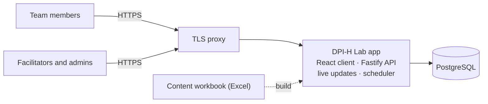

# DPI-H Lab

**Digital Public Infrastructure for Health – Lab.** Country teams map their DPI-H pathway together: they agree on a use case, assess their readiness, decide who decides, check which digital building blocks they have, map their architecture, and agree a national priority, a 12-month action and a regional candidate.

Everyone in a team opens the same worksheet on their own device and edits it together in real time. Facilitators run sessions for one team or many and see every team's progress live.

### ▶ Use it: **[dpih.fhirlab.net](https://dpih.fhirlab.net)**

Got a code from your facilitator? Enter it on the home page. Just curious? Start a **practice group** there, with no sign-up needed.

The tool is informed by the WHO/ITU *Reference Architecture and Guidance for Digital Public Infrastructure for the Health Sector (DPI-H)*, Draft V1.0. It is not produced or endorsed by WHO or ITU.

## How a session works

1. **A facilitator sets up a session:** a dated **workshop** or an **open session**, for **one team** or **several**. Each team represents a country, or is any group, for example regional experts.
2. **The facilitator shares a code.** A **workshop code** (`E-ABC123`) lets people pick their team; a **team code** (`ABC-123`) goes straight to one team. Both also come as links and QR codes.
3. **The team works through eight steps together**, each person on their own device:

   | Step | What the team does |
   |---|---|
   | 0 Team | Who is in the team |
   | 1 Use case | Agree one use case to focus on |
   | 2 Readiness | Rate the foundations: governance, legal, workforce, funding |
   | 3 Who decides | Who holds each decision, and on what legal basis |
   | 4 Components | Which DPI-H building blocks are needed, and whether they exist |
   | 5 Mapping | The systems in use today, layer by layer |
   | 6 Pathway | National priority, 12-month action, costs, regional candidate |
   | 7 Summary | A 60-second readout; **Submit**, with an optional consent to share |

4. **The facilitator follows progress live**, can view any team, and downloads the results.

Want to run a session for your country or region? [Open an issue](https://github.com/sscproject/dpi-h-lab/issues/new/choose) to get in touch with the authors.

## Data and privacy

- Every team's answers stay with that team: nothing can be read without the team's code or a facilitator's sign-in.
- The tool collects no patient or personal health information. Team members' names are optional and are hidden from anyone opening a closed team with its code.
- Sharing results beyond the team is the team's choice, made when they submit.

## How it's built

TypeScript throughout: React 19 and Vite in the browser; Node.js 24, Fastify and PostgreSQL on the server; Server-Sent Events for live editing. Every label and definition comes from an Excel content workbook, so the wording can be improved without changing code.

More detail, diagrams and the security design: **[docs/architecture.md](docs/architecture.md)**.

## About

DPI-H Lab was developed as a follow-up to the **Asia-Pacific Digital Health Interoperability Bootcamp (Sydney, 2026)**, supported by the **Strengthening Standards Capability Project (SSCP)**. It was authored by **Umer Nisar (CSIRO SSCP)** in collaboration with **Rumanusina Maua (SPC)** and **Jordi Piera Jimenez**. See [AUTHORS](AUTHORS).

## Get involved

- **Found a problem, or have an idea?** [Open an issue](https://github.com/sscproject/dpi-h-lab/issues/new/choose). There is a form for wording and definition improvements too.
- **Want to contribute code or content?** See [CONTRIBUTING.md](CONTRIBUTING.md).
- **Found a security problem?** Please report it privately: see [SECURITY.md](SECURITY.md).

Everyone taking part follows the [Code of Conduct](CODE_OF_CONDUCT.md).

## Licence and attribution

- **Code:** Apache License 2.0 ([LICENSE](LICENSE)).
- **Content** (definitions, prompts, glossary, interface wording in `content/`): Creative Commons Attribution 4.0 ([LICENSE-CONTENT.md](LICENSE-CONTENT.md)).
- **Attribution is required.** Keep the [NOTICE](NOTICE) file and credit the authors in anything you share or build from this work, including the credits or "about" page of any application built from it:

  > Based on DPI-H Lab by Umer Nisar (CSIRO SSCP), Rumanusina Maua (SPC) and Jordi Piera Jimenez (https://github.com/sscproject/dpi-h-lab), licensed under Apache-2.0 (code) and CC BY 4.0 (content).

Copyright 2026 The DPI-H Lab authors.
