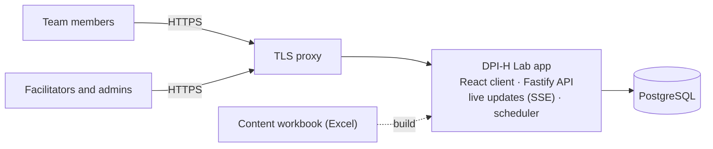

# DPI-H Lab

**Digital Public Infrastructure for Health – Lab.** A web tool where country teams map their DPI-H pathway together: they agree on a use case, assess their readiness, decide who decides, check which digital building blocks they have, map their architecture, and agree a national priority, a 12-month action and a regional candidate.

Everyone in a team opens the same worksheet on their own device and edits it together in real time. Facilitators run sessions for one team or many and see every team's progress live.

The tool is informed by the WHO/ITU *Reference Architecture and Guidance for Digital Public Infrastructure for the Health Sector (DPI-H)*, Draft V1.0. It is not produced or endorsed by WHO or ITU.

**Licence:** code [Apache-2.0](LICENSE) · content [CC BY 4.0](LICENSE-CONTENT.md) · **attribution to the authors is required**, see [NOTICE](NOTICE).

## About

DPI-H Lab was developed as a follow-up to the **Asia-Pacific Digital Health Interoperability Bootcamp (Sydney, 2026)**, supported by the **Strengthening Standards Capability Project (SSCP)**. It was authored by **Umer Nisar (CSIRO SSCP)** in collaboration with **Rumanusina Maua (SPC)** and **Jordi Piera Jimenez**. See [AUTHORS](AUTHORS).

## How it works

1. **A facilitator signs in** and creates a session: a dated **workshop** or an **open session**, for **one team** or **several**. Each team represents a country, or has any team name (for example, a group of regional experts).
2. **The facilitator shares a code.** A **workshop code** (`E-ABC123`) lets people pick their team from the session's list; a **team code** (`ABC-123`) goes straight to one team. Both come as links and QR codes.
3. **Team members enter the code** on the home page, add their names, and work through eight steps together:

   | Step | What the team does |
   |---|---|
   | 0 Team | Who is in the team (the country and team name are set by the facilitator) |
   | 1 Use case | Agree one use case to focus on |
   | 2 Readiness | Rate the foundations: governance, legal, workforce, funding |
   | 3 Who decides | Who holds each decision, and on what legal basis |
   | 4 Components | Which DPI-H building blocks are needed, and whether they exist |
   | 5 Mapping | The systems in use today, layer by layer |
   | 6 Pathway | National priority, 12-month action, costs, regional candidate |
   | 7 Summary | A 60-second readout; **Submit**, with an optional consent to share |

4. **The facilitator watches progress live**, can view any team read-only, and exports the results (CSV, JSON, Excel, edit log).
5. **Admins** see every session and team and manage facilitator accounts.

Anyone can try it with a **practice group** from the home page; practice groups can be shared for 24 hours and are then deleted.

## Architecture



**Stack:** TypeScript throughout · React 19 + Vite · Node.js 24 + Fastify + Zod · PostgreSQL 16 (PGlite for local development and tests) · Server-Sent Events for live updates · Vitest · Docker.

Details, diagrams, data model and the security design: **[docs/architecture.md](docs/architecture.md)**.

## Run it locally

You need **Node.js 22 or later** (24 LTS recommended).

```bash
npm install
npm run dev
```

- Web app: http://localhost:5173
- API: http://localhost:3000

No database install is needed: without `DATABASE_URL` the server uses PGlite and keeps its data in `.data/pglite`.

**First sign-in:** the server prints a one-time **setup code** in its log. Open http://localhost:5173/staff, enter the code, and create the first **Super Admin** account. Then create a session and add teams.

### With Docker

```bash
cp .env.example .env      # then set JWT_SECRET to a long random value
docker compose up --build
```

Then open http://localhost:3000. The Compose file is for a local trial only (both ports stay on this machine).

### Commands

| Command | What it does |
|---|---|
| `npm run dev` | Server and client with live reload |
| `npm test` | Unit and API tests (against an in-memory database) |
| `npm run typecheck` | TypeScript checks for client and server |
| `npm run content:build` | Validates the content workbook and writes `content/content.json` |
| `npm run build` then `npm start` | Production build, then run the server (it serves the built client) |
| `npm run migrate` | Applies database migrations (also runs on server start) |

Settings are environment variables; see [.env.example](.env.example).

## Project layout

```
client/    React web client: home page, worksheet, staff screens (sign-in, admin, sessions)
server/    Fastify API: routes/ (public, staff), sessions and teams, staff accounts,
           live updates (SSE), exports, database layer, migrations/
shared/    Rules used by both sides: worksheet schema and validation, codes, countries,
           content IDs, summary
content/   Content workbook (Excel) and the generated content.json
scripts/   content-build.ts
tests/     Vitest tests
docs/      Architecture
```

## Changing the wording

Every label, definition, prompt, glossary term and piece of interface text comes from `content/DPI-H_Pathway_Lab_Content_v1.xlsx` (sheets `Items`, `Steps`, `Glossary`, `UI_Text`).

1. Edit the workbook in Excel. Keep IDs unchanged.
2. Raise the version on its `README` sheet (e.g. 1.61 → 1.62). Published versions never change.
3. Run `npm run content:build` and fix anything the validator reports.
4. Restart the server. New teams use the new version; existing teams keep theirs (the footer always uses the newest wording).

`shared/ui-keys.ts` lists every `UI_Text` key the app reads; the build fails if one is missing.

## Deploying

The reference deployment is one small Linux server running Docker Compose with:

- a TLS proxy in front (for example Caddy with Let's Encrypt), and the app and database ports kept private
- the app container from this repository's `Dockerfile`, with `NODE_ENV=production`, a random `JWT_SECRET` of at least 32 characters, `PUBLIC_URL` set to the site address, and `TRUST_PROXY=1` behind one proxy
- PostgreSQL 16, with regular backups stored off the server

Database migrations run automatically when the server starts.

## Contributing

Issues and pull requests are welcome. See **[CONTRIBUTING.md](CONTRIBUTING.md)**, and report security problems privately as described in **[SECURITY.md](SECURITY.md)**. Everyone taking part follows the [Code of Conduct](CODE_OF_CONDUCT.md).

## Licence and attribution

- **Code:** Apache License 2.0 ([LICENSE](LICENSE)).
- **Content** (`content/`): Creative Commons Attribution 4.0 ([LICENSE-CONTENT.md](LICENSE-CONTENT.md)).
- **Attribution is required.** Keep the [NOTICE](NOTICE) file and credit the authors in anything you distribute or build from this work, including in the credits or "about" page of an application built from it:

  > Based on DPI-H Lab by Umer Nisar (CSIRO SSCP), Rumanusina Maua (SPC) and Jordi Piera Jimenez (https://github.com/sscproject/dpi-h-lab), licensed under Apache-2.0 (code) and CC BY 4.0 (content).

Copyright 2026 The DPI-H Lab authors.
