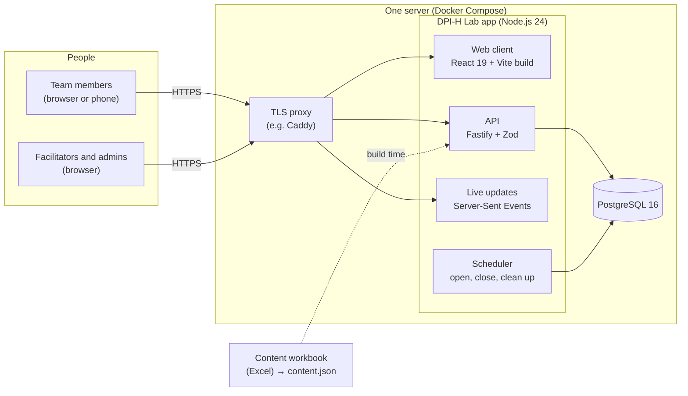
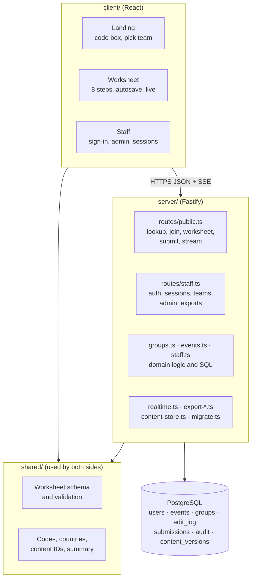
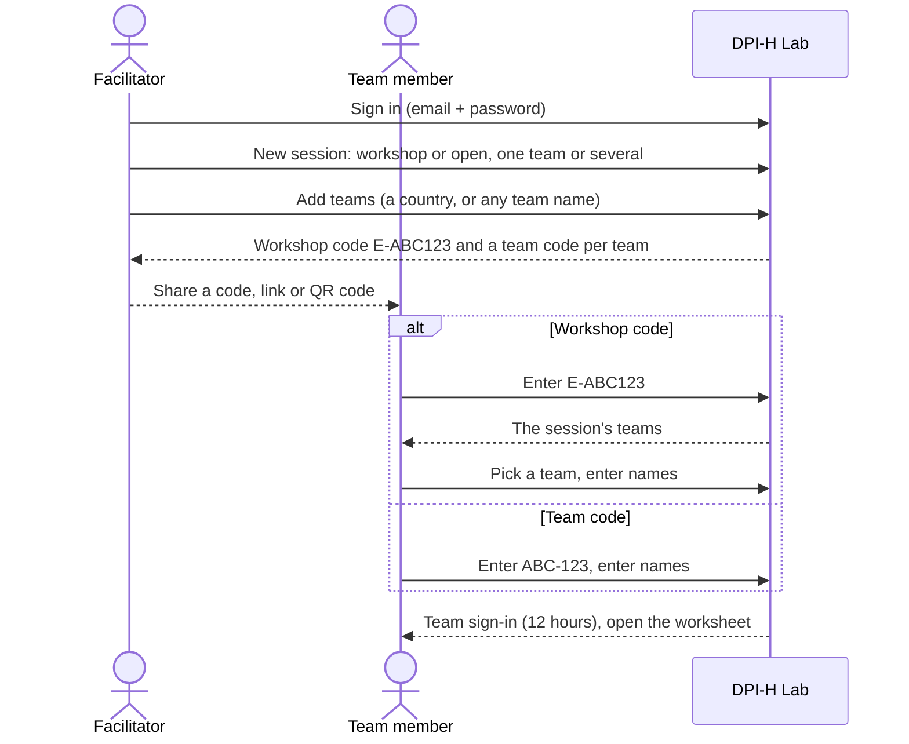
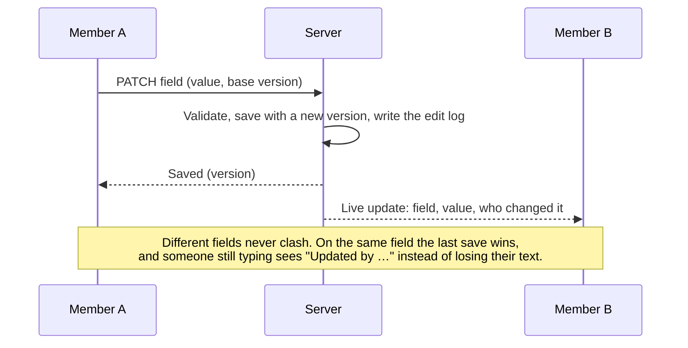
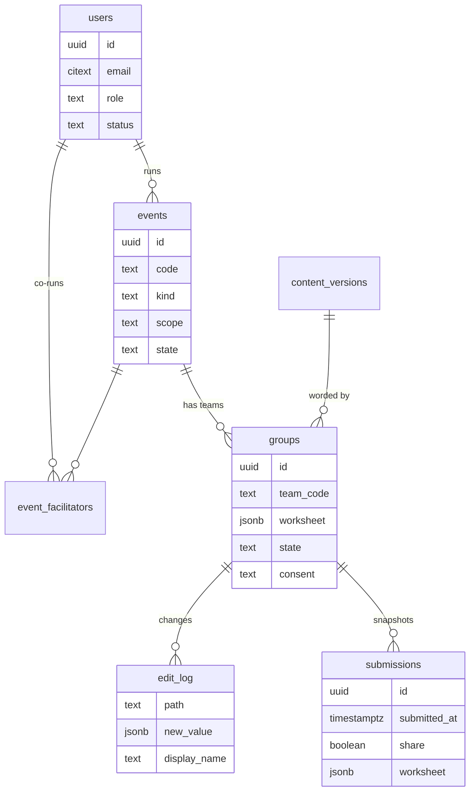

# DPI-H Lab architecture

DPI-H Lab is a single web application: a React client and a Node.js API server in one repository, with PostgreSQL for storage. One server process serves the API, the live updates and the built web pages.

## The system at a glance

- **Client** (`client/`): React 19 single-page app built with Vite. Team members use the worksheet; staff use the sign-in, admin and session screens. All interface text and definitions come from the content workbook.
- **API** (`server/`): Fastify with Zod validation. Three groups of routes: public (codes, joining, the worksheet), staff (sign-in, sessions, teams, admin) and exports.
- **Live updates** (`server/realtime.ts`): each open worksheet keeps a Server-Sent Events stream. The server pushes saved changes, who is online and state changes; clients send edits over normal HTTPS. SSE works through most proxies and needs no extra service.
- **Scheduler**: every few seconds the server opens sessions at their start time, closes them at their end time or after days without activity, and deletes practice groups after 24 hours.
- **Database** (`server/db.ts`): PostgreSQL in production. Locally and in tests the same SQL runs on PGlite (PostgreSQL compiled to WebAssembly), so no database install is needed.
- **Content** (`content/`): an Excel workbook is the source of every label, definition, prompt and glossary term. `npm run content:build` validates it and writes `content.json`; each published version is immutable, and each team keeps the version it started with.

## Layers

## How people get in

There is one way in for teams, decided by the code they enter on the home page. Facilitators set everything up first.

The only other way in is a **practice group**: anyone can start one from the home page, share it for 24 hours, and then it is deleted.

## Saving and live editing

- Every answer belongs to the team and is stored on the server. Closing a browser loses nothing.
- The browser keeps only its sign-in, the current step and, while offline, a queue of unsent edits.
- Every change goes into the edit log, so it is possible to see how a team reached its answer.
- **Submit** (Summary step) saves a dated copy of the answers with the team's data-sharing choice. Later submissions show progress over time.

## Roles and access

| Who | How they sign in | What they can do |
|---|---|---|
| Team member | Workshop or team code, plus names | Edit their own team's worksheet; submit |
| Facilitator | Email and password | Create sessions, add and edit teams, run the live dashboard, export their sessions |
| Co-facilitator | Email and password | Run a session they were added to (not delete it or manage co-facilitators) |
| Admin | Email and password | Everything above for every session and team; manage facilitators |
| Super Admin | Email and password | Everything; manage admins |

Every request is checked live: a team sign-in only opens its own team and ends if the facilitator issues a new team code; staff sign-ins end when an account is deactivated, its role changes or its password changes.

## Data

The worksheet is stored as one flat JSON object per team (`{"cp.CR.need": "yes", …}`) with a version per field. `shared/worksheet.ts` defines every allowed path and value, and the server rejects anything else.

## Security design

- **No public lists.** Nothing about a team can be read without that team's code or a staff sign-in.
- **Codes:** 6 characters from a 32-character alphabet without look-alike letters. Wrong codes are limited per address (per /64 for IPv6) and across all addresses.
- **Passwords:** scrypt hashes only; the first Super Admin needs a one-time setup code from the server log; passwords set by an admin must be changed at first sign-in.
- **Input:** every field is validated against the schema; all SQL is parameterised; CSV exports neutralise formula-like cells; React escapes all text.
- **Headers:** strict Content Security Policy (`'self'` only), HSTS and the other Helmet defaults.
- **Privacy:** team members' and buddies' names are withheld from people reading a closed team with its code. The app collects no patient data.

See [SECURITY.md](../SECURITY.md) to report a vulnerability.

## Deployment shape

The reference deployment is one small Linux server running Docker Compose: a TLS proxy (Caddy), the app container and PostgreSQL, with database backups taken off the server. One server handled a 200-person load test comfortably. Running several app instances would need a shared channel for live updates (for example PostgreSQL `LISTEN/NOTIFY`), because the live hub is in memory.
